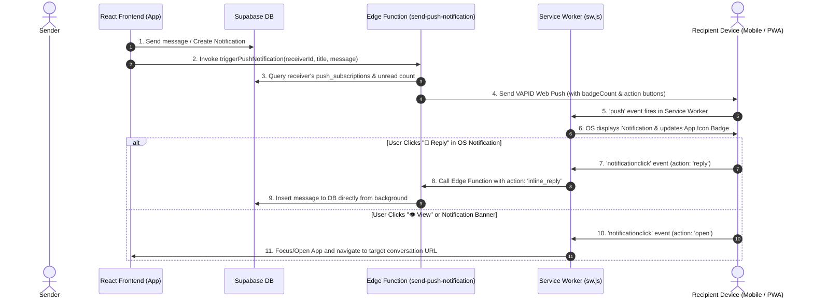

# PWA Web Push Notifications, App Icon Badging & Inline OS Reply Guide

This document provides a comprehensive, step-by-step implementation guide for the Web Push Notification system, App Icon Badging, Inline OS Reply, and Click Navigation in the **TalentOps** PWA / Mobile App.

---

## Architecture Overview



---

## Step 1: Database Schema & VAPID Setup

### 1.1 Database Table (`push_subscriptions`)
Create the table to store device push endpoints for each user:

```sql
CREATE TABLE IF NOT EXISTS public.push_subscriptions (
    id UUID DEFAULT gen_random_uuid() PRIMARY KEY,
    user_id UUID NOT NULL REFERENCES auth.users(id) ON DELETE CASCADE,
    endpoint TEXT NOT NULL UNIQUE,
    p256dh_key TEXT NOT NULL,
    auth_key TEXT NOT NULL,
    device_info TEXT,
    created_at TIMESTAMPTZ DEFAULT NOW(),
    updated_at TIMESTAMPTZ DEFAULT NOW()
);

-- Enable RLS
ALTER TABLE public.push_subscriptions ENABLE ROW LEVEL SECURITY;

-- RLS Policies
CREATE POLICY "Users can manage their own subscriptions"
ON public.push_subscriptions
FOR ALL
USING (auth.uid() = user_id)
WITH CHECK (auth.uid() = user_id);
```

### 1.2 VAPID Keys Configuration
Web Push uses asymmetric VAPID keys for authentication:
- **Public Key**: Exposed to the frontend to request browser push permissions.
- **Private Key**: Kept safe in Supabase Edge Function environment secrets.

---

## Step 2: Service Worker Core (`sw.js`)

The Service Worker runs in the background even when the app is completely closed.

### 2.1 Handling Push Events & Badging
```javascript
// sw.js - Push Event Listener
self.addEventListener('push', (event) => {
  let payload = {};
  if (event.data) {
    try { payload = event.data.json(); }
    catch { payload = { body: event.data.text() }; }
  }

  const { title, options } = buildNotificationOptions(payload);

  // 1. Update App Icon Badge on Home Screen
  if ('setAppBadge' in navigator) {
    const badgeCount = Number(payload.badgeCount || payload.unreadCount || 1);
    if (!isNaN(badgeCount) && badgeCount > 0) {
      navigator.setAppBadge(badgeCount).catch(() => {});
    } else {
      navigator.clearAppBadge().catch(() => {});
    }
  }

  // 2. Show OS Notification
  event.waitUntil(self.registration.showNotification(title, options));
});
```

### 2.2 Building OS Notification Options (with Action Buttons)
```javascript
function buildNotificationOptions(payload) {
  const title = payload.title || payload.sender_name || 'TalentOps';
  const body = payload.body || payload.message || 'You have a new notification.';
  const type = payload.type || 'general';
  const conversationId = payload.conversationId || payload.data?.conversation_id;

  let url = payload.url || (conversationId ? `/?conversationId=${conversationId}` : '/');

  return {
    title,
    options: {
      body,
      icon: '/pwa-192x192.png',
      badge: '/pwa-192x192.png',
      vibrate: [200, 100, 200, 100, 200],
      tag: `talentops-${type}-${conversationId || Date.now()}`,
      renotify: true,
      // OS Action Buttons (Inline reply + View redirection)
      actions: type === 'message' ? [
        { action: 'reply', title: '💬 Reply', type: 'text', placeholder: 'Type a reply...' },
        { action: 'open', title: '👁 View' },
        { action: 'dismiss', title: '✕ Dismiss' }
      ] : [
        { action: 'open', title: '👁 View' },
        { action: 'dismiss', title: '✕ Dismiss' }
      ],
      data: { url, conversationId, type }
    }
  };
}
```

### 2.3 Handling Notification Clicks & Inline OS Reply
```javascript
self.addEventListener('notificationclick', (event) => {
  event.notification.close();
  const action = event.action;
  const data = event.notification.data || {};
  const targetUrl = data.url || '/';

  if (action === 'dismiss') return;

  // Handle Inline OS Reply (User typed inside OS notification prompt)
  if (action === 'reply') {
    const replyText = (event.reply || '').trim();
    if (replyText && data.conversationId) {
      event.waitUntil((async () => {
        // Send reply directly via Edge Function without opening browser tab
        await fetch('https://srv1674496.hstgr.cloud/functions/v1/send-push-notification', {
          method: 'POST',
          headers: { 'Content-Type': 'application/json' },
          body: JSON.stringify({
            action: 'inline_reply',
            conversation_id: data.conversationId,
            content: replyText
          })
        });
      })());
      return;
    }
  }

  // View Redirection: Open or Focus App Window
  event.waitUntil((async () => {
    const fullUrl = new URL(targetUrl, self.location.origin).href;
    const clientList = await self.clients.matchAll({ type: 'window', includeUncontrolled: true });

    for (const client of clientList) {
      if ('focus' in client) {
        client.postMessage({ type: 'NOTIFICATION_CLICKED', url: targetUrl });
        if ('navigate' in client) await client.navigate(fullUrl);
        await client.focus();
        return;
      }
    }

    if (self.clients.openWindow) await self.clients.openWindow(fullUrl);
  })());
});
```

---

## Step 3: Frontend Push Service (`pushNotificationService.ts`)

### 3.1 Subscribing Device to Web Push
```typescript
export async function subscribeUserToPush() {
  if (!('serviceWorker' in navigator) || !('PushManager' in window)) return;

  const permission = await Notification.requestPermission();
  if (permission !== 'granted') return;

  const registration = await navigator.serviceWorker.ready;
  let subscription = await registration.pushManager.getSubscription();

  if (!subscription) {
    subscription = await registration.pushManager.subscribe({
      userVisibleOnly: true,
      applicationServerKey: urlBase64ToUint8Array(VAPID_PUBLIC_KEY)
    });
  }

  const { data: { user } } = await supabase.auth.getUser();
  if (user) {
    await savePushSubscriptionToSupabase(subscription.toJSON(), user.id);
  }
}
```

### 3.2 Triggering Web Push Notification
```typescript
export async function triggerPushNotification(
  receiverId: string,
  title: string,
  message: string,
  type: string = 'general',
  url: string = '/',
  conversationId?: string
) {
  return fetch('https://srv1674496.hstgr.cloud/functions/v1/send-push-notification', {
    method: 'POST',
    headers: { 'Content-Type': 'application/json' },
    body: JSON.stringify({
      receiver_id: receiverId,
      title,
      message,
      type,
      url,
      conversationId
    })
  });
}
```

---

## Step 4: Realtime Badging & In-App Popups (`MessageContext.jsx`)

### 4.1 Syncing App Icon Badge in Foreground
```javascript
const totalUnreadCount = Math.max(unreadCount, unreadNotifCount);

useEffect(() => {
  if (typeof window !== 'undefined') {
    const count = Number(totalUnreadCount || 0);

    // 1. Direct Web App Badging API
    if ('setAppBadge' in navigator) {
      if (count > 0) navigator.setAppBadge(count).catch(() => {});
      else navigator.clearAppBadge().catch(() => {});
    }

    // 2. Post to Service Worker for background launcher sync
    if ('serviceWorker' in navigator && navigator.serviceWorker.controller) {
      navigator.serviceWorker.controller.postMessage({ type: 'SET_BADGE', count });
    }
  }
}, [totalUnreadCount]);
```

### 4.2 Realtime Postgres Changes Subscription
```javascript
const channel = supabase
  .channel(`messages-rt-${userId}`)
  .on(
    'postgres_changes',
    {
      event: 'INSERT',
      schema: 'public',
      table: 'notifications',
      filter: `receiver_id=eq.${userId}` // Required for Supabase Realtime RLS streaming
    },
    (payload) => {
      // Trigger toast popup & update badge
      addNotification(payload.new);
      fetchUnreadNotifCount(userId);
    }
  )
  .subscribe();
```

---

## Step 5: Supabase Edge Function (`send-push-notification/index.ts`)

The Edge Function receives notification requests, calculates the receiver's badge count, and sends VAPID Web Push packets to all registered devices.

```typescript
import webpush from 'https://esm.sh/web-push@3.6.7';

webpush.setVapidDetails(VAPID_SUBJECT, VAPID_PUBLIC_KEY, VAPID_PRIVATE_KEY);

serve(async (req) => {
  const payload = await req.json();

  // 1. Handle Inline OS Reply
  if (payload.action === 'inline_reply') {
    await supabase.from('messages').insert({
      conversation_id: payload.conversation_id,
      sender_user_id: payload.sender_user_id,
      content: payload.content
    });
    return new Response(JSON.stringify({ success: true }));
  }

  // 2. Query Target User's Device Endpoints & Unread Count
  const { data: subscriptions } = await supabase
    .from('push_subscriptions')
    .select('*')
    .eq('user_id', payload.receiver_id);

  const { count: unreadCount } = await supabase
    .from('notifications')
    .select('*', { count: 'exact', head: true })
    .eq('receiver_id', payload.receiver_id)
    .eq('is_read', false);

  const badgeCount = Math.max(1, unreadCount || 0);

  // 3. Dispatch Web Push
  const pushPayload = JSON.stringify({
    title: payload.title,
    body: payload.message,
    conversationId: payload.conversationId,
    badgeCount,
    unreadCount: badgeCount
  });

  for (const sub of subscriptions) {
    await webpush.sendNotification(
      { endpoint: sub.endpoint, keys: { auth: sub.auth_key, p256dh: sub.p256dh_key } },
      pushPayload,
      { TTL: 86400, urgency: 'high' }
    );
  }

  return new Response(JSON.stringify({ success: true }));
});
```

---

## Step 6: PWA Manifest Configuration (`vite.config.ts`)

To ensure app icon badges work seamlessly on Android Chrome PWA and Safari iOS PWA:

```typescript
manifest: {
  id: '/', // Required for App Badging API
  name: 'TalentOps',
  short_name: 'TalentOps',
  display: 'standalone',
  scope: '/',
  start_url: '/',
  icons: [
    { src: 'pwa-192x192.png', sizes: '192x192', type: 'image/png', purpose: 'any' },
    { src: 'pwa-512x512.png', sizes: '512x512', type: 'image/png', purpose: 'any' },
    { src: 'pwa-maskable-512x512.png', sizes: '512x512', type: 'image/png', purpose: 'maskable' }
  ]
}
```

---

## Step-by-Step Testing & Verification Guide

### 📱 Android Testing (Chrome / Edge PWA)
1. Open the website on Android Chrome.
2. Tap **"Add to Home Screen"** or **"Install App"**.
3. Launch the app from the Home Screen.
4. When prompted, tap **"Allow Notifications"**.
5. Send a message to this account from another device:
   - **Background**: Close the app. A notification banner with **"💬 Reply"** & **"👁 View"** buttons appears, and a red numeric badge count appears on the Home Screen icon.
   - **Inline Reply**: Tap **"💬 Reply"**, type text, and press Send. The message is posted directly to DB without opening the app.
   - **Click Redirection**: Tap **"👁 View"** or banner — the app opens directly to that conversation.

### 🍎 iOS Testing (Safari PWA on iOS 16.4+)
1. Open the website in Safari on iPhone.
2. Tap the **Share** button -> **"Add to Home Screen"**.
3. Launch the app from the Home Screen launcher icon.
4. Allow notification permissions when prompted.
5. Send a test notification:
   - iOS displays the push notification on the Lock Screen / Notification Center and updates the App Badge on the app launcher icon.
